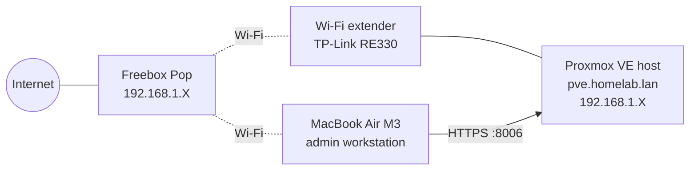

# 🧪 Homelab

> Hands-on journey from zero to **Cybersecurity & Cloud Architect** — built one project at a time on a single mini-PC at home.

I'm a first-year Maths & Computer Science student (Université Lyon 1). This repository documents every project of my homelab: what I built, the commands I used, what broke, and how I fixed it. The goal is to practise the three pillars of my future job — **Network · Cybersecurity · Cloud** — on real infrastructure, not just in theory.

---

## 🖥️ Hardware

| Component | Details |
|---|---|
| Server | Dell OptiPlex 7060 Micro (refurbished) |
| CPU | Intel Core i5-8600T — 6 cores / 6 threads, up to 3.7 GHz, 35 W |
| RAM | 8 GB DDR4 (1 free slot — upgrade path to 32 GB) |
| Storage | 256 GB NVMe SSD (free 2.5" bay for a future data disk) |
| Network | 1 GbE Intel I219-LM, connected via a TP-Link RE330 Wi-Fi extender |
| Hypervisor | Proxmox VE 9.2 (Debian 13 "Trixie", kernel 7.0) |
| Admin workstation | MacBook Air M3 |

## 🗺️ Architecture (current)



*Private IPs only — no public addresses, serial numbers or credentials are published in this repository.*

## 📈 Progress

### Phase 1 — Virtualisation, Linux & networking (8 weeks)

| Week | Projects | Status |
|---|---|---|
| [01 — Know your server & Proxmox](semaine-01/) | 01 Hardware inventory · 02 Proxmox install · 03 Proxmox administration · 03b Server relocation | ✅ Done |
| 02 — Virtual machines | 04 Debian VM · 05 Second Linux VM · 06 Snapshots | ⏳ Next |
| 03 — Linux command line | 07 File structure · 08 Users & permissions · 09 First Bash script | 🔜 |
| 04 — Remote administration | 10 SSH keys · 11 Services & logs · 12 Automated maintenance | 🔜 |
| 05 — Linux networking | 13 Network map · 14 VM-to-VM · 15 Isolated network | 🔜 |
| 06 — Hosting services | 16 Nginx · 17 LXC container · 18 Linux firewall | 🔜 |
| 07 — Backup & troubleshooting | 19 Backup/restore · 20 Resource tracking · 21 Incident simulation | 🔜 |
| 08 — Hardening & capstone | 22 Security audit · 23 Full Linux infra · **24 Capstone: architecture dossier** | 🔜 |

### Later phases

| Phase | Focus | Highlights |
|---|---|---|
| 2 — Network services | Routing, DNS/DHCP, packet analysis, monitoring | OPNsense, Pi-hole, Wireshark, Grafana |
| 3 — Security lab | Segmentation, PKI, Active Directory, SIEM, purple team | VLANs, WireGuard, Wazuh, Kali vs vulnerable VMs (isolated) |
| 4 — Cloud & hybrid | Secure AWS, IaC, hybrid VPN | Terraform, site-to-site VPN, GuardDuty, threat modeling |

## 📂 Repository structure

```
semaine-NN/            one folder per week (Phase 1)
  NN-project-name/     one folder per project
    README.md          Objective · Steps · Commands · Tests · Problems & fixes · Result
    screenshots/
docs/diagrams/         architecture diagrams
```

## 🔐 Security rules for this repo

- No passwords, keys, tokens, public IPs, serial numbers or service tags.
- Screenshots are checked and blurred before being committed.
- Offensive security labs run only on my own machines, on an isolated network.

---

*Each project README follows the same structure so a reader can see not only what works, but how I think when things don't.*
