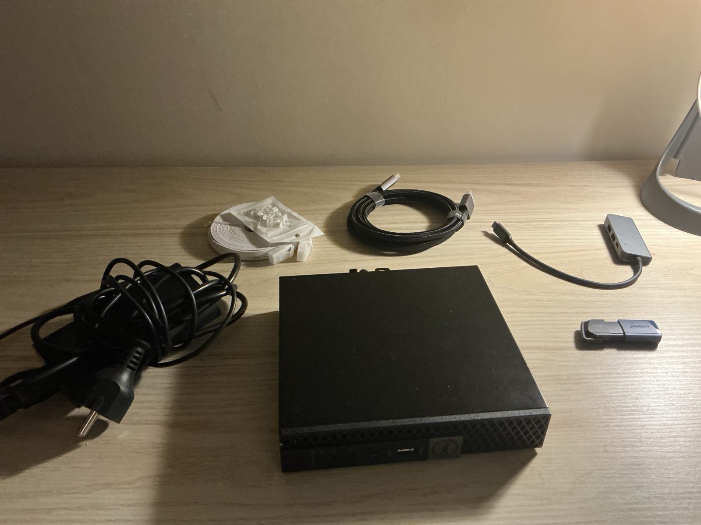
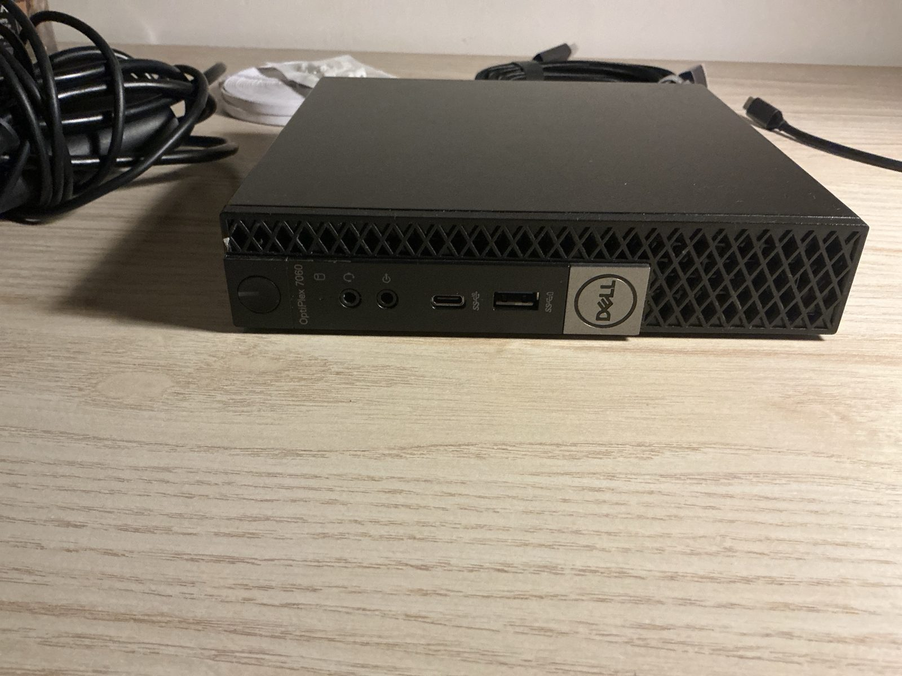
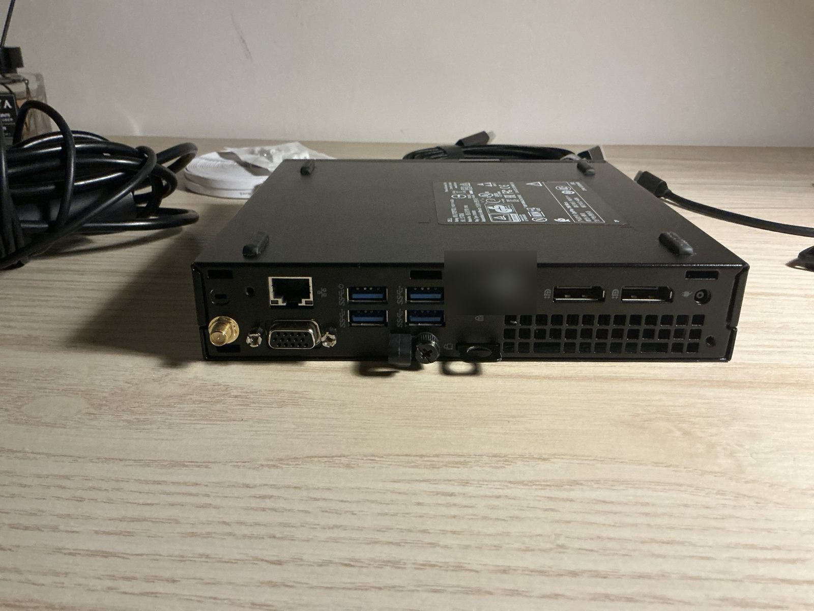
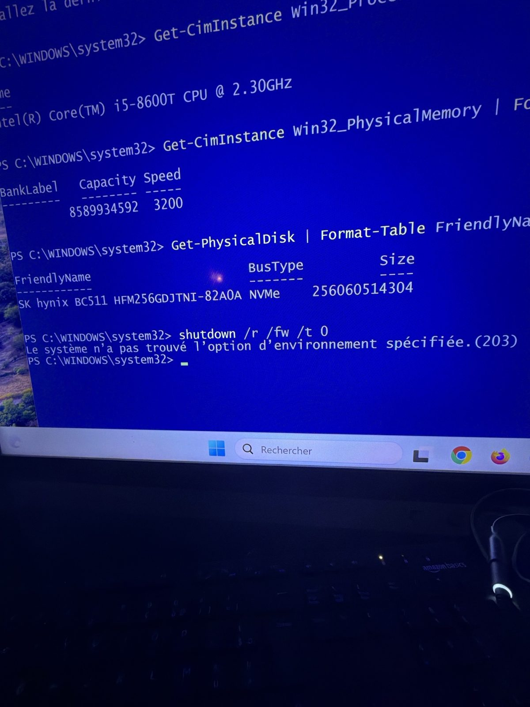
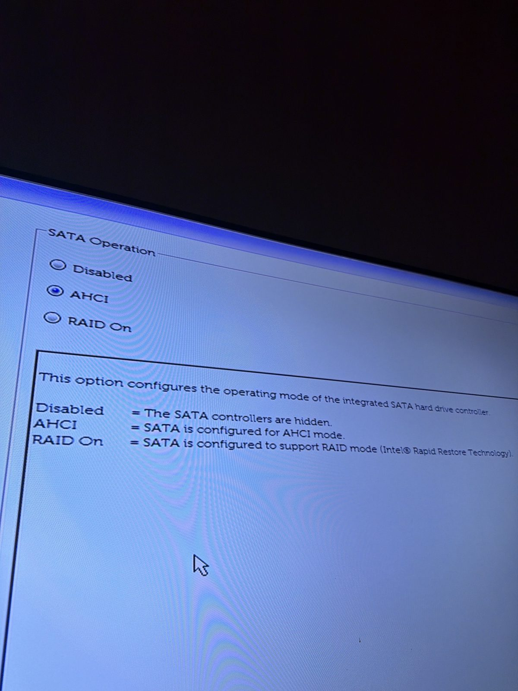
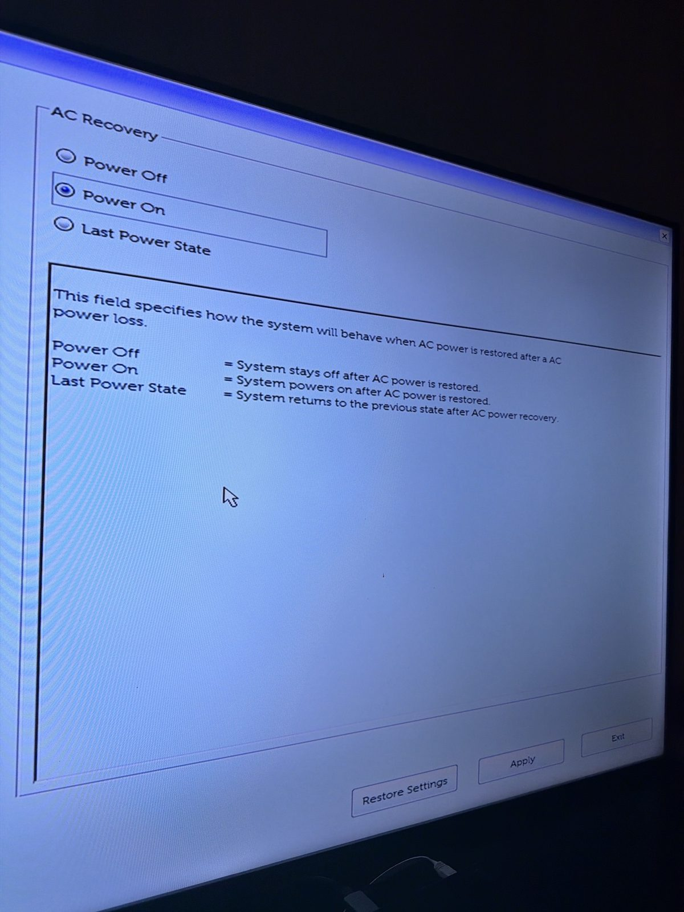

# 01 — Hardware inventory

## Objective
Identify exactly what hardware I received (a Dell OptiPlex 7060 Micro sent instead of the HP EliteDesk I ordered) before wiping it, so I can plan VM capacity and future upgrades.

## Steps
1. Inspected the chassis: model sticker, rear and front ports.
2. Booted the pre-installed Windows 11 once and queried the hardware from **PowerShell (admin)**.
3. Entered the BIOS (F2) to check the virtualisation and storage settings.

## Commands used
```powershell
Get-CimInstance Win32_Processor        # CPU model
Get-CimInstance Win32_PhysicalMemory   # one line per RAM stick
Get-PhysicalDisk                       # disk model and bus type
```

## Results
| Component | Finding | Why it matters |
|---|---|---|
| CPU | Intel Core i5-8600T, 6C/6T, 35 W | Slightly better than advertised (i5-8500); low power for 24/7 use |
| RAM | **1 × 8 GB** DDR4 SO-DIMM | One slot free → 16 GB is cheap; 32 GB (2 × 16) is the platform max |
| Disk | SK hynix BC511 256 GB **NVMe** | Fast; a free 2.5" SATA bay allows a future data disk |
| Video | 2 × DisplayPort, 1 × VGA, **no HDMI** | Needed a DisplayPort → HDMI cable for the TV |
| Network | 1 × Gigabit Ethernet (Intel I219-LM) | Wi-Fi card present but unusable for a Proxmox bridge |

### BIOS check
| Setting | Value |
|---|---|
| Virtualization (VT-x) | Enabled ✅ |
| VT for Direct I/O (VT-d) | Enabled ✅ |
| SATA Operation | AHCI ✅ |
| AC Recovery | Changed to **Power On** (server restarts after a power cut) |

## Problems & fixes
| Problem | Fix |
|---|---|
| Missed the F2 window twice — Windows booted instead | Windows *Fast Startup* skips the firmware prompt on a cold boot → used **Restart** from Windows, then F2 |
| `shutdown /r /fw` failed (error 203) | This firmware doesn't support "reboot to UEFI" from Windows → manual F2 after a restart |

## Screenshots
Service tag blurred, EXIF/GPS metadata stripped from every photo.

| | |
|---|---|
| Unboxing: Dell OptiPlex 7060 Micro, power brick, cables, USB key |  |
| Front |  |
| Rear ports: RJ45, 4 × USB-A, VGA, 2 × DisplayPort, **no HDMI** (service tag blurred) |  |
| Inventory from Windows before wiping it: CPU, RAM (`Get-CimInstance`), NVMe disk (`Get-PhysicalDisk`), and a failed `shutdown /r /fw` attempt |  |
| BIOS: SATA Operation set to **AHCI** |  |
| BIOS: AC Recovery set to **Power On** (server restarts after a power cut) |  |
