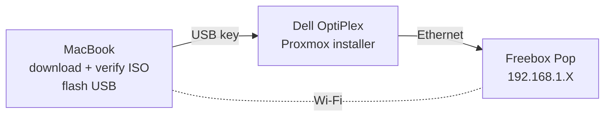
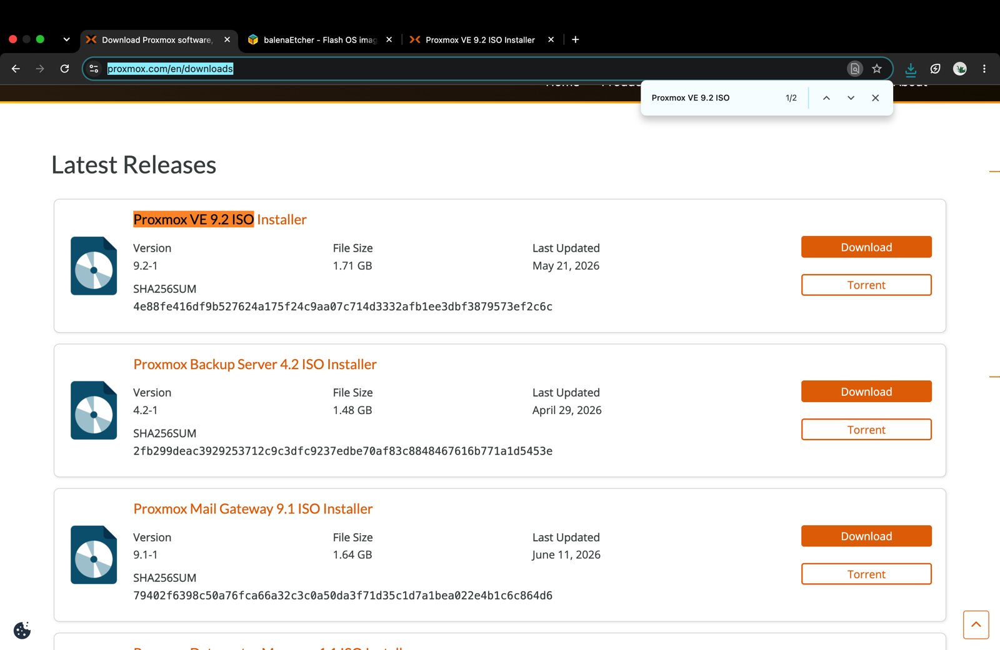
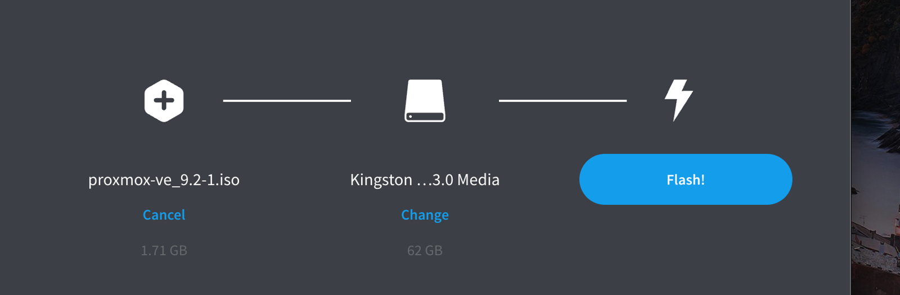
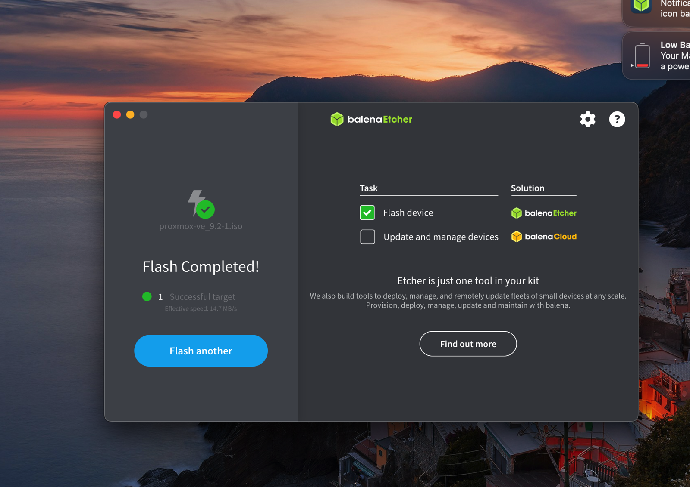
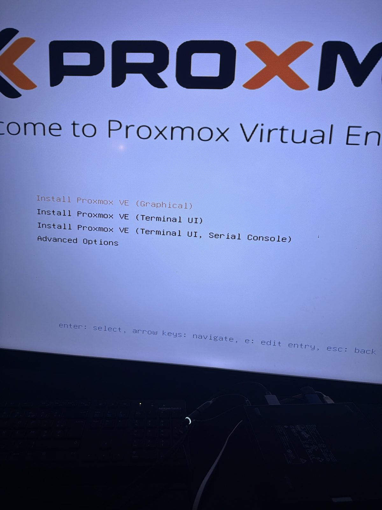

# 02 — Proxmox VE installation

## Objective
Install Proxmox VE 9.2 bare-metal on the Dell, with a static management IP, and reach its web interface from my Mac.

## Architecture


## Steps
1. Downloaded `proxmox-ve_9.2-1.iso` from the official site and **verified its SHA256**.
2. Flashed it to a USB key with balenaEtcher (Etcher re-reads the key to validate it).
3. Gathered network info from the Mac (gateway, own IP) and picked a static IP **outside the router's DHCP range** (Freebox DHCP ends at .200).
4. Booted the Dell from USB (F12 → UEFI: Kingston) and ran the **Terminal UI** installer (keyboard only).
5. Installed on the NVMe disk with **ext4** (ZFS needs more RAM than 8 GB comfortably allows).
6. Logged into the web UI from the Mac at `https://192.168.1.X:8006`.

## Commands used
```bash
# Verify the ISO (macOS)
shasum -a 256 ~/Downloads/proxmox-ve_9.2-1.iso
# expected: 4e88fe41...3ef2c6c (published on proxmox.com)

# Find the router and the Mac's IP (macOS)
route -n get default | grep gateway
ipconfig getifaddr en0

# Check the server is reachable
ping -c 4 192.168.1.X
```

## Configuration
| Setting | Value |
|---|---|
| Filesystem | ext4 on `/dev/nvme0n1` |
| Country / Timezone / Keyboard | France / Europe/Paris / French (AZERTY) |
| Hostname | `pve.homelab.lan` |
| IP | `192.168.1.X/24` (static) |
| Gateway / DNS | `192.168.1.X` (Freebox) |

## Tests
- [x] `ping 192.168.1.X` → 4/4 replies, 0 % loss
- [x] Web UI reachable on port 8006 and login as `root@pam` works
- [x] Server boots from SSD with the USB key removed

## Problems & fixes
| Problem | Cause | Fix |
|---|---|---|
| **ISO checksum mismatch** (`62a2dd…` instead of `4e88fe…`) | Corrupted download | Deleted the file, re-downloaded from the official page, checksum matched |
| `shasum: Operation not permitted` | macOS privacy protection blocks Terminal from `~/Downloads` | Granted Terminal access in *Privacy & Security → Files and Folders* |
| Installer showed placeholder network values | Ethernet cable not plugged into the router | Connected the Dell to the Freebox's free LAN port |
| Browser: `ERR_ADDRESS_UNREACHABLE` | Tried before Proxmox finished booting | `ping` confirmed connectivity; reloaded once boot completed |
| Browser: `ERR_CERT_AUTHORITY_INVALID` | Proxmox uses a **self-signed** certificate | Expected on my own LAN server — accepted for now; internal PKI planned later |

## What I learned
A checksum is the only way to know a file is exactly what the publisher released — size alone proves nothing. And a static IP for a server must sit outside the DHCP range, or the router may hand the same address to another device.

## Screenshots
Installer summary and network screens are not published: they show my email and real IP addresses.

| | |
|---|---|
| Official download page with the published **SHA256** |  |
| Flashing the ISO to the USB key with balenaEtcher |  |
| Flash completed |  |
| Proxmox installer boot menu on the Dell |  |
