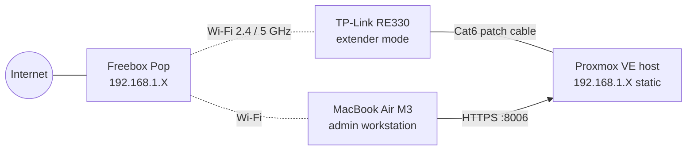
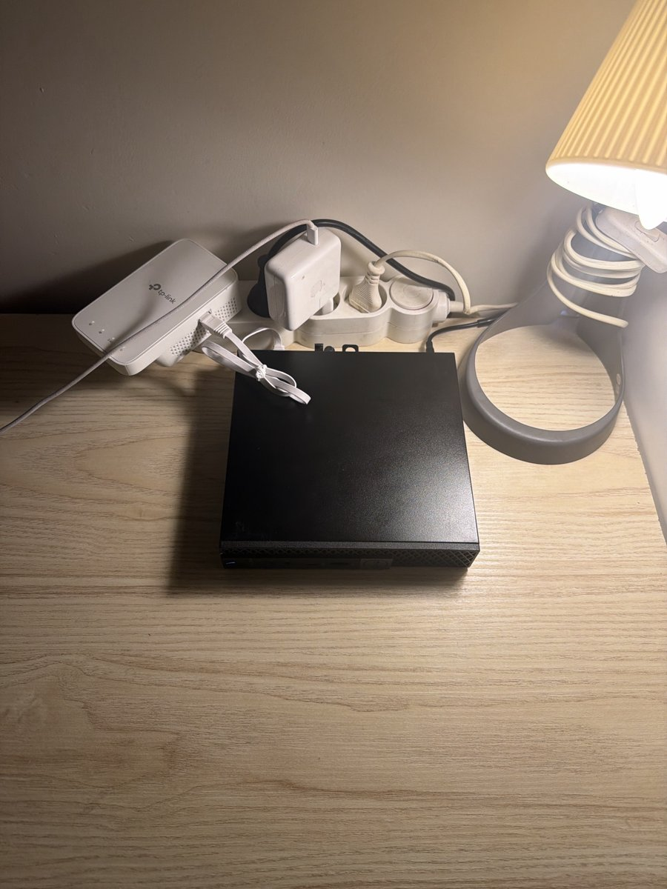
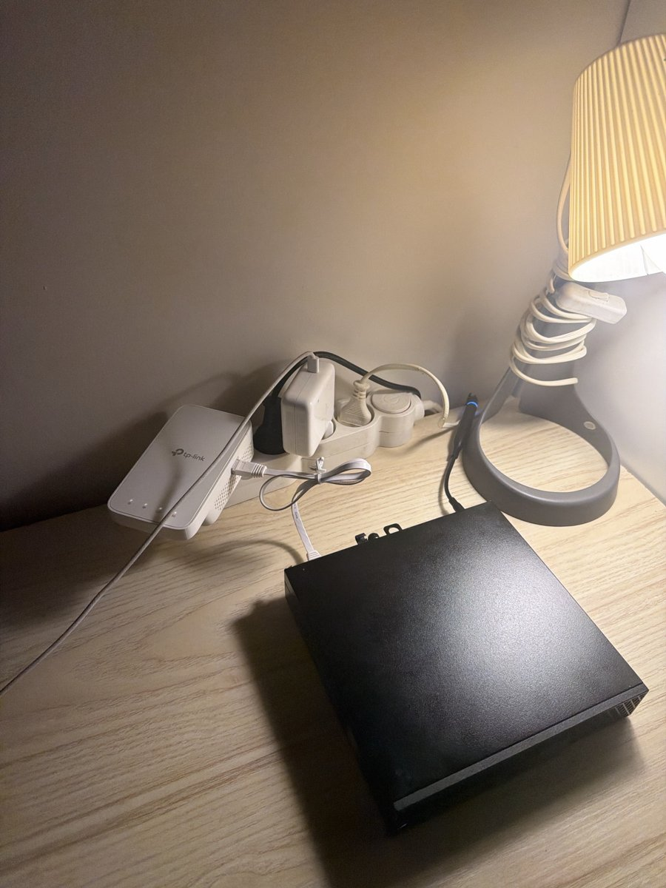

# 03b — Server relocation behind a Wi-Fi extender

## Objective
Move the Proxmox server from the living room (next to the Freebox) to my bedroom desk, where there is no Ethernet socket, **without changing its IP address or breaking remote administration**.

## Design choice: Wi-Fi extender vs powerline (CPL) vs Wi-Fi card

| Option | Pros | Cons | Verdict |
|---|---|---|---|
| Built-in Wi-Fi card | No extra hardware | A Wi-Fi client **can't be bridged** into `vmbr0`, so VMs would lose direct network access. Unreliable on a hypervisor | ❌ |
| Powerline adapters (CPL) | Wired feel | Depends on the electrical wiring. Must be plugged directly into a wall socket, not a power strip | ❌ |
| **Wi-Fi extender with an Ethernet port** (TP-Link RE330) | Speed test at the desk was 440–560 Mbps with 5 ms latency. Works from a power strip. Gives the server a real RJ45 link | One extra wireless hop | ✅ |

## Architecture



## Steps
1. **Set up the extender.** I paired the RE330 with the Freebox through the TP-Link Tether app (*Add a Range Extender*), extending both bands. Then I placed it where its signal LED turned white, meaning good signal.
2. **Shut the server down cleanly** from the web UI (*Node → Shutdown*), never by pulling the power cable. This avoids filesystem corruption.
3. **Moved the server** to the desk and connected the RE330's Ethernet port to the server's NIC with a short Cat6 cable.
4. **Power:** one wall socket → one power strip. No daisy-chained strips. I replaced an old strip that was buzzing, which is a sign of a fault.
5. **Powered on** and waited for Proxmox to boot.

## Prediction before powering on
> *Will the server keep its IP address?*

**Yes.** The IP is **static**, configured on the host, so it doesn't depend on DHCP. The extender works as a **layer-2 bridge**: it extends the Freebox network instead of creating a new subnet with NAT. The server stays on the same subnet with the same gateway.

## Tests

**Web UI:** reachable at the same address. The node was online, the scheduled `apt update` tasks returned OK, and the version was 9.2.26.

**Ping from the Mac:**
```bash
ping -c 4 192.168.1.X
```
```
64 bytes from 192.168.1.X: icmp_seq=0 ttl=64 time=17.519 ms
64 bytes from 192.168.1.X: icmp_seq=1 ttl=64 time=52.759 ms
64 bytes from 192.168.1.X: icmp_seq=2 ttl=64 time=15.703 ms
64 bytes from 192.168.1.X: icmp_seq=3 ttl=64 time=19.131 ms
4 packets transmitted, 4 packets received, 0.0% packet loss
round-trip min/avg/max/stddev = 15.703/26.278/52.759/15.337 ms
```

| Observation | Interpretation |
|---|---|
| 0 % packet loss | Link is up and stable |
| `ttl=64` | Linux starts at TTL 64 and each router decrements it. Receiving 64 means **no router between Mac and server**, which confirms the extender bridges rather than routes |
| ~26 ms avg, one 52 ms spike | Expected with **two wireless hops** (Mac → Freebox → RE330). Wi-Fi is a shared medium with jitter. That's fine for administration and lab VMs |

## Screenshots

| Before tidying | After tidying |
|---|---|
|  |  |

After tidying, the Ethernet cable runs behind the server instead of over it. There is free space behind for hot-air exhaust, and the front intake is unobstructed.

## Problems & fixes
| Problem | Fix |
|---|---|
| Old power strip was buzzing | Discarded it. A buzzing strip is a fire hazard |
| Unsure whether WPS was needed to pair the extender | Not needed: the Tether app paired it using the Wi-Fi password |
| Ethernet cable coiled on top of the server | Routed it behind the server so it can't be pulled by accident |

## To watch next
Some Wi-Fi extenders rewrite the MAC addresses of devices behind their Ethernet port. In **project 04**, I'll check that a VM on `vmbr0`, which has its own MAC, still gets a DHCP lease and internet access.

## Result
✅ Server relocated to the bedroom desk. Same static IP, no reconfiguration needed, remote administration works, and the physical setup is safe and tidy.
