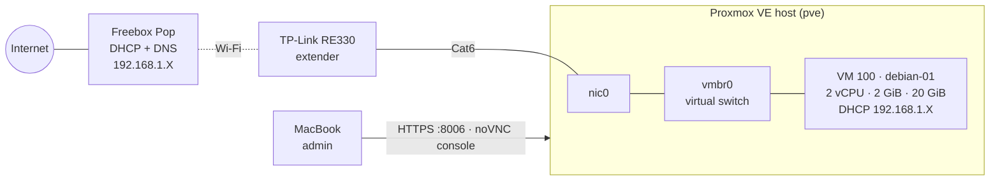
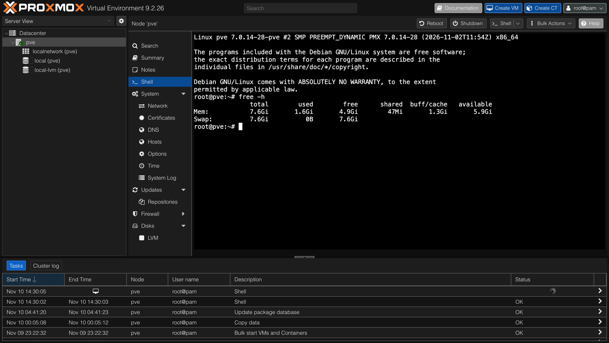
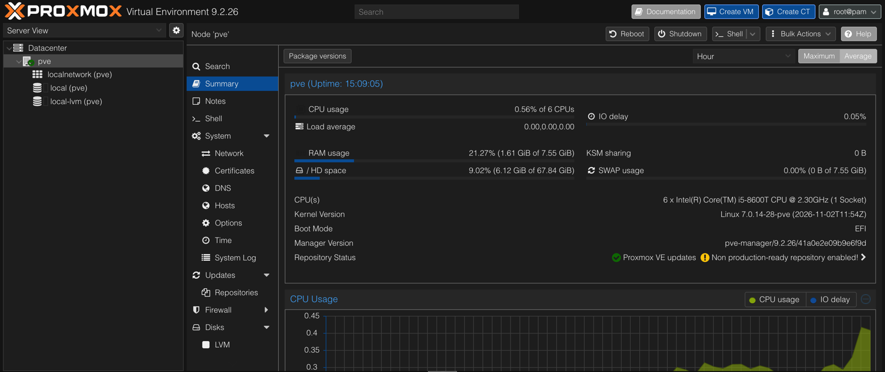
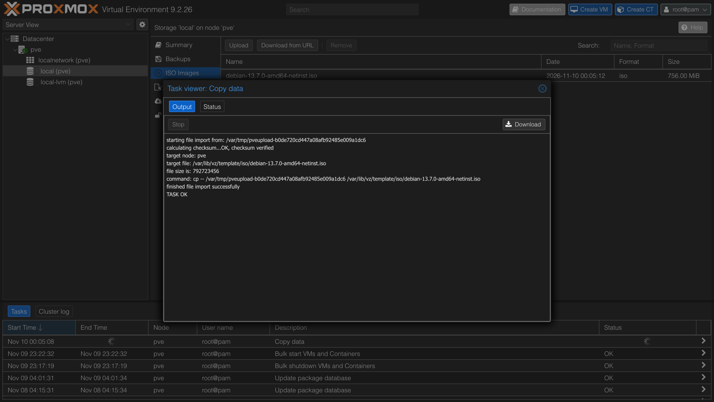
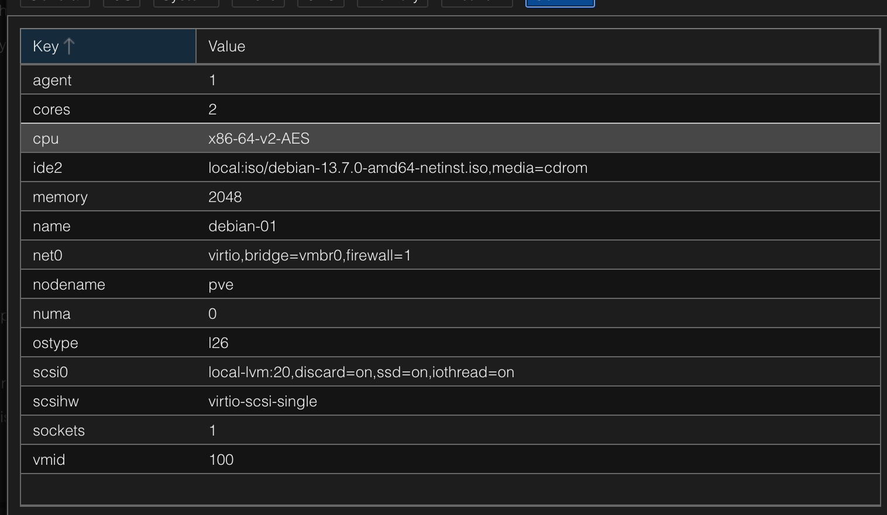
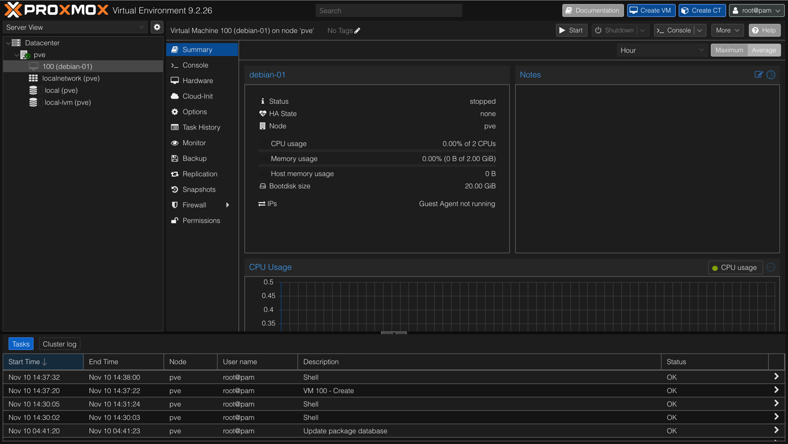
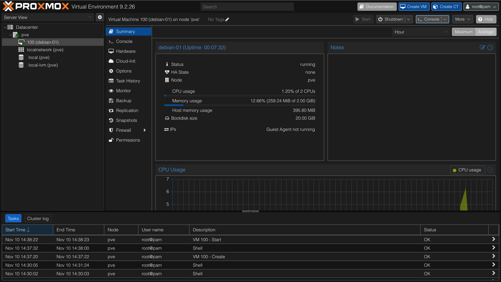
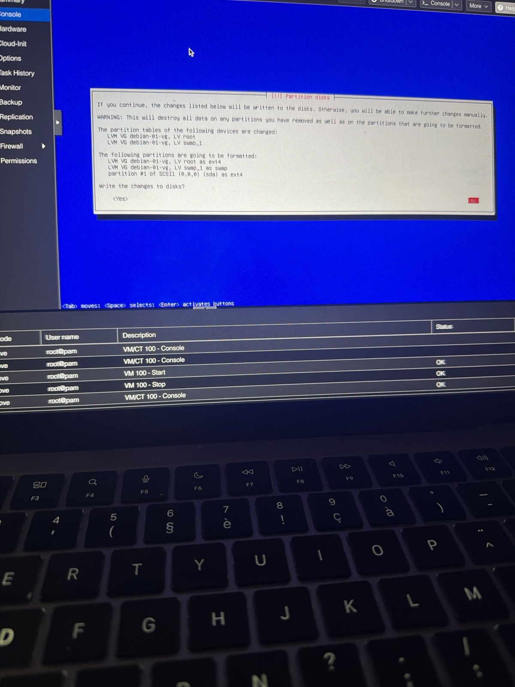
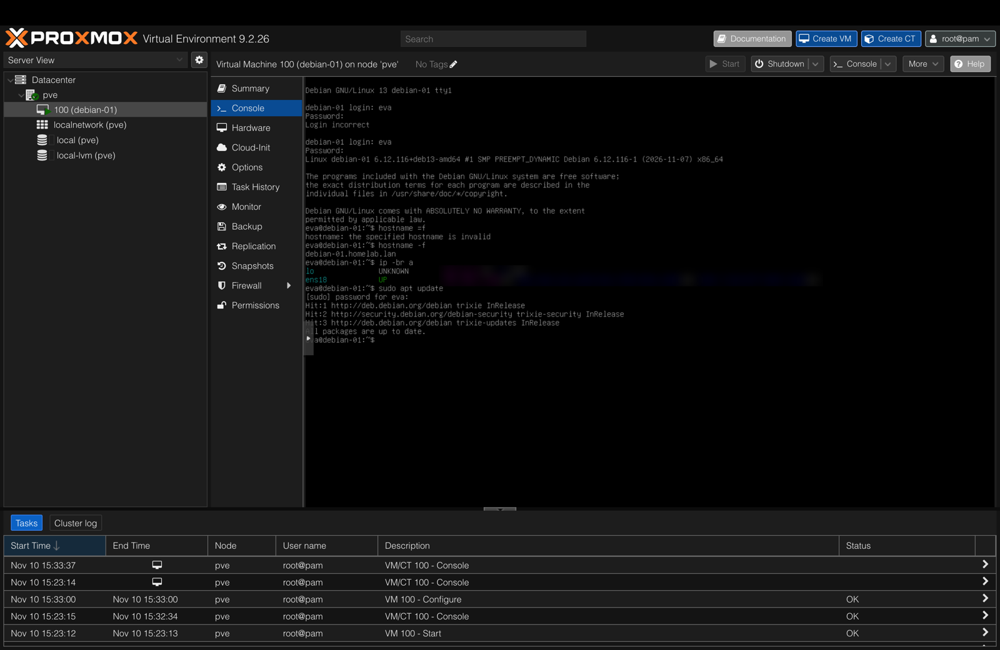
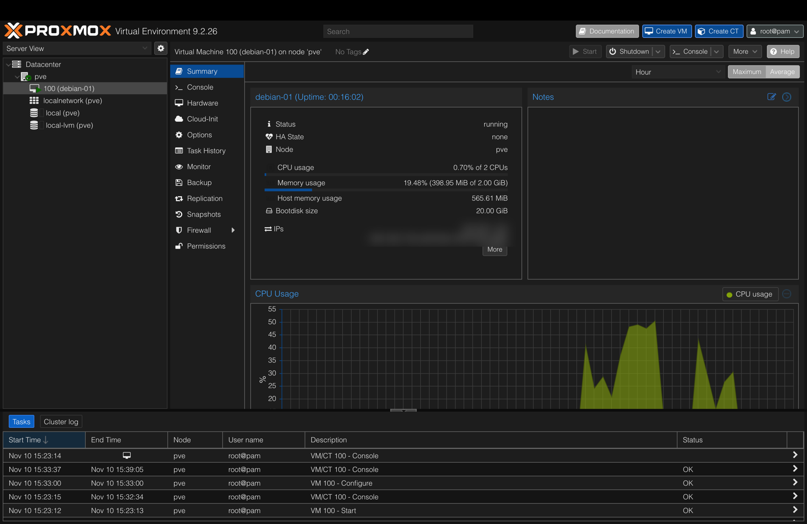

# 04 — First Debian Server VM

## Objective
Create my first virtual machine on Proxmox: a **Debian 13 server with no graphical interface** (2 vCPU, 2 GB RAM, 20 GB disk). Then verify that it gets network access behind my Wi-Fi extender and that Proxmox can manage it cleanly.

## Architecture



## Sizing decision
I measured the host before creating anything:

| `free -h` on the host | used | available | swap used |
|---|---|---|---|
| Before the VM | 1.6 GiB | 5.9 GiB | 0 B |
| With the VM running | 2.4 GiB | 5.1 GiB | 0 B |

The VM costs about **0.8 GiB on the host**: ~566 MiB of guest RAM actually touched, plus ~200 MB of QEMU overhead. 8 GB is enough for two 2 GiB VMs plus a safety margin. RAM is the bottleneck. vCPUs can be shared between VMs, but RAM can't.

## Steps

### 1. Get and verify the ISO
- Downloaded `debian-13.7.0-amd64-netinst.iso`, the **amd64** build. The VM runs on the Dell's Intel CPU, so the Mac's ARM chip doesn't matter.
- Verified it **twice**:
  1. On the Mac, against Debian's official `SHA256SUMS` file.
  2. Proxmox checked it again during upload, before copying the file into the ISO library ("verify before storing").

```bash
curl -sO https://cdimage.debian.org/debian-cd/current/amd64/iso-cd/SHA256SUMS
grep "debian-13.7.0-amd64-netinst.iso" SHA256SUMS | shasum -a 256 -c -
# debian-13.7.0-amd64-netinst.iso: OK
```

### 2. Create the VM (Proxmox wizard)
| Tab | Setting | Why |
|---|---|---|
| System | **Qemu Agent** ✅ | Lets Proxmox see the guest's IP and shut it down cleanly |
| Disks | SCSI on `local-lvm`, **20 GiB**, **Discard** ✅, **SSD emulation** ✅, IO thread ✅, no cache | Thin provisioning: only data actually written uses space, and Discard returns freed blocks. No cache is the safe choice without a UPS |
| CPU | 1 socket × 2 cores, type `x86-64-v2-AES` | A generic CPU model keeps the VM portable, and AES-NI makes encryption fast |
| Memory | 2048 MiB, ballooning device ✅ (min = max) | A fixed 2 GiB is predictable, and the balloon driver still reports real memory usage |
| Network | `vmbr0`, **VirtIO** | The fastest paravirtualised NIC, on the same bridge as the host |

The resulting config file is `/etc/pve/qemu-server/100.conf`. A Proxmox VM is basically **a small text file plus a disk volume**.

### 3. Install Debian (text installer)
- Language **English** (error messages are easier to search), location France, locale `en_US.UTF-8`, keymap **French**.
- Hostname `debian-01`, domain `homelab.lan`.
- **Root password left empty.** That disables root login, and my user gets `sudo` instead. Attackers can't target a known username, and every admin command is logged against a real account.
- Partitioning: **Guided, entire disk with LVM**, all files in one partition. LVM layers: PV `/dev/sda5` → VG `debian-01-vg` → LVs `root` (19.3 GB, ext4) and `swap_1` (1.1 GB), plus `/boot` (1 GB) outside LVM.
- Software: **no desktop environment**. Only **SSH server** and **standard system utilities**.

### 4. First boot and checks
```bash
hostname -f                     # debian-01.homelab.lan
ip -br a                        # ens18 UP 192.168.1.X/24 (+ IPv6)
sudo apt update                 # sudo works, internet works, all up to date
systemctl status qemu-guest-agent   # active (running)
```

## Screenshots
| Step | Screenshot |
|---|---|
| Host baseline before any VM: `free -h` (1.6 GiB used, swap 0) |  |
| Host baseline in the GUI: RAM 1.61 / 7.55 GiB, KSM 0 B |  |
| ISO checksum verified by Proxmox on upload |  |
| VM configuration before creation |  |
| VM 100 created (stopped, 0 B host memory) |  |
| First start: the installer uses ~396 MiB of host RAM, and the agent isn't installed yet |  |
| Partition summary (LVM, `debian-01-vg`) |  |
| First login and checks: `hostname -f`, `ip -br a`, `sudo apt update` (IPs blurred) |  |
| VM running with Guest Agent reporting IPs (blurred) |  |

## Tests
| Test | Result |
|---|---|
| ISO integrity (Mac + Proxmox) | ✅ checksum OK twice |
| VM gets a DHCP lease **behind the Wi-Fi extender** | ✅ IPv4 from the Freebox, same subnet as the host |
| Internet access from the VM | ✅ 1,000+ packages downloaded; `apt update` OK |
| `sudo` with root disabled | ✅ |
| Guest Agent: Proxmox shows the VM's IPs | ✅ |
| **Shutdown** from Proxmox (graceful, via agent) | ✅ stopped in 2 s |
| Start boots straight into Debian (ISO ejected, disk first) | ✅ `debian-01 login:` |

## Problems & fixes
| Problem | Cause | Fix / lesson |
|---|---|---|
| Installer started "speech synthesis" by itself | Debian's accessibility feature: if no key is pressed on the boot menu, it assumes a blind user | Reset the VM and choose **Install** within the 30 s countdown |
| Hostname pre-filled as `re3302` | The installer did a reverse-DNS lookup of its DHCP IP, and the Freebox named the device after the **Wi-Fi extender** (a sign of MAC translation by the RE330) | Clear the field and type `debian-01` |
| Typing `-` gave `=` | The noVNC console sends **physical key positions**, and the guest uses a PC AZERTY layout. The Mac's `-` key sits where PC AZERTY has `=` | On a Mac, press the **§ 6** key to get `-` in the VM |
| Volume group named `re3302-vg` | The VG name comes from the hostname, which hadn't been saved | **Read the summary before confirming.** Went back and redid it |
| GNOME desktop started installing | Pressed **Enter** (validate the screen) instead of **Space** (toggle a checkbox), so the default desktop tasks stayed selected | Stopped the VM and reinstalled cleanly (1,379 files avoided) |
| Stuck on "Booting from Hard Disk…" | Boot order was disk first, and the half-installed disk had no GRUB | Put the CD (`ide2`) first in **Options → Boot Order** |
| Boot order change ignored after Reset | Boot order is passed to QEMU **when it starts**. Reset reboots inside the same QEMU process, so the change stays **pending (orange)** | **Stop + Start** applies pending changes |
| noVNC "Authentication failed" | The console's one-time ticket expired when the VM stopped | Reopen the Console tab to get a new ticket |
| Screenshot shortcut went into the VM | The console captures the keyboard | Click outside the console first, or photograph the screen |

## Security notes
- 🔐 Root login disabled; admin through `sudo` only, which leaves an audit trail.
- 🔐 No GUI and minimal packages give a **smaller attack surface**.
- 🔐 The Freebox hands out a **public IPv6** address to the VM. IPv6 has no NAT to hide behind, so the router's IPv6 firewall is what protects it. Address blurred in screenshots; firewalling will be covered in project 18.
- 🔐 The MAC prefix `BC:24:11` is registered to Proxmox, so a network scan instantly reveals "this is a Proxmox VM" (reconnaissance).
- 🔐 KSM (memory page sharing between VMs) is harmless in a single-owner lab, but it enables cross-tenant side-channels. That's why public clouds disable it between customers.

## Result
✅ `debian-01` is running as a headless Debian 13 server on Proxmox. It has network and internet access behind the Wi-Fi extender, sudo-only administration, LVM storage, and a working Guest Agent for clean shutdowns and IP reporting.

**Next:** project 05 (a second Linux VM, compared with this one) and project 06 (snapshots: break it, then roll back).
