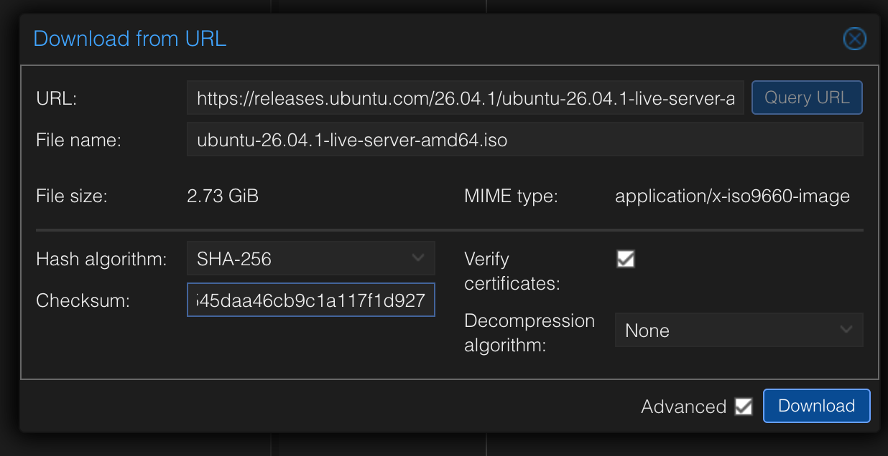
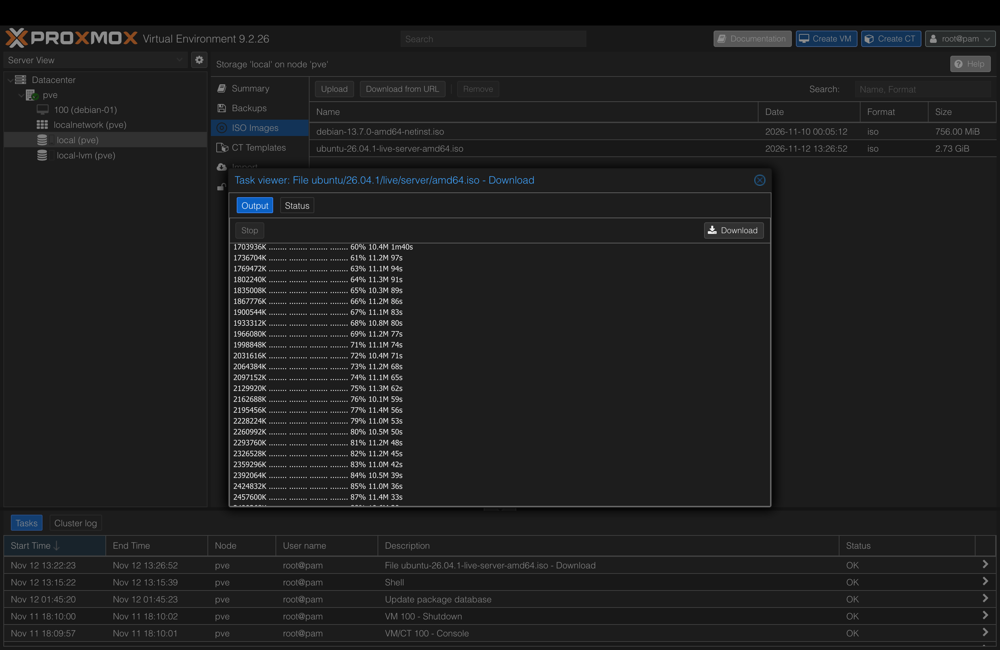

# 05 — Second Linux VM: Ubuntu Server (and how it differs from Debian)

> 🚧 **In progress.** This README is written step by step during the project, mistakes included.

## Objective
Install **Ubuntu Server 26.04.1 LTS** as a second VM next to `debian-01`, then **compare the two distributions**: installer, defaults, resource usage and philosophy. The goal isn't just "I installed Ubuntu", but understanding why a company would choose one or the other.

## Concept: same family, different choices
Ubuntu is built **on top of Debian**: Canonical takes Debian, adds its own choices and tooling, and ships a release every 6 months, with an LTS every 2 years. Same family (`apt`, `systemd`, same filesystem layout), but different defaults.

| | Debian 13 | Ubuntu Server 26.04 LTS |
|---|---|---|
| Made by | Volunteer community | A company (Canonical) |
| Philosophy | Stable, minimal, "you decide" | Up to date, "batteries included" |
| Installer | Classic text installer (d-i) | **Subiquity**, a newer, guided installer |
| Root account | Optional (I disabled it) | Always disabled, sudo user by default |
| Extras | Almost none | Snaps, cloud-init, Ubuntu Pro… |
| Where you meet it | Many servers and appliances (**Proxmox itself runs on Debian**) | The most common Linux in the public cloud (AWS / Azure / GCP images) |

Why both matter for my goal: Debian is under my hypervisor; Ubuntu is what I'll meet in the cloud (Phase 4).

## Prediction before starting
> The Ubuntu Server ISO is **2.7 GB**, the Debian netinst was **756 MB**. Why ~4× bigger?

_My answer and the real reason will be added here._

## Steps

### 1. Download the ISO directly on Proxmox (with checksum)
This time the ISO goes straight from Ubuntu's servers to the Proxmox host (**local → ISO Images → Download from URL**), instead of Mac → upload. The 2.7 GB never pass through my laptop.

| Field | Value | Why |
|---|---|---|
| URL | `https://releases.ubuntu.com/26.04.1/ubuntu-26.04.1-live-server-amd64.iso` | Official source, HTTPS |
| Query URL | file name + **2.73 GiB**, MIME `application/x-iso9660-image` | Proxmox checks the link works and that it's really a disc image |
| Hash algorithm | **SHA-256** | |
| Checksum | the 64-hex hash from the official `SHA256SUMS`, line `ubuntu-26.04.1-live-server-amd64.iso` | Proxmox refuses to keep the file if the hash doesn't match |
| Verify certificates | ✅ | Makes sure I'm really talking to `releases.ubuntu.com` |

**Result:** task **OK** (13:22:23 → 13:26:52, ~4.5 min). The ISO is now in the library next to Debian's (2.73 GiB vs 756 MiB). Download speed was steady around **11 MB/s ≈ 90 Mbit/s**, much lower than the 440–560 Mbit/s Wi-Fi speed test at the desk: the Wi-Fi extender relays everything over the same radio (roughly halving throughput), and the remote mirror's speed matters too.

The release folder also contains `SHA256SUMS.gpg`: a **signature** of the hash list, proving it comes from Canonical (same idea as Debian's `.sign`).

## Problems & fixes
| Problem | Cause | Fix / lesson |
|---|---|---|
| The ISO also started downloading **on my Mac** | I clicked the ISO link on the Ubuntu page | Cancelled it. Proxmox downloads its own copy; only the hash needs to be copied from the site |
| Typed `SHA256SUMS` in the Checksum field | Confused the **name** of the hash list with the **hash** itself | Opened `SHA256SUMS` and copied the 64-character hex string. Caught before downloading 2.7 GB for nothing |
| Two `live-server` lines in `SHA256SUMS` | The folder holds **26.04** (April) and **26.04.1** (August) | Took the `26.04.1` line, matching the file I'm downloading, and copied it from the official page myself, never from a third party |
