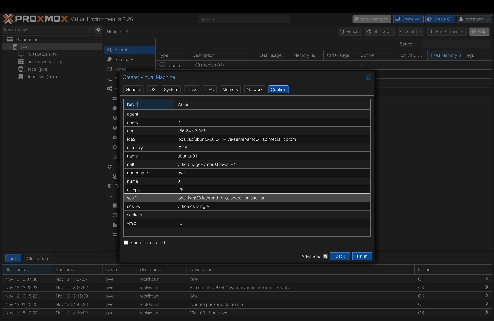
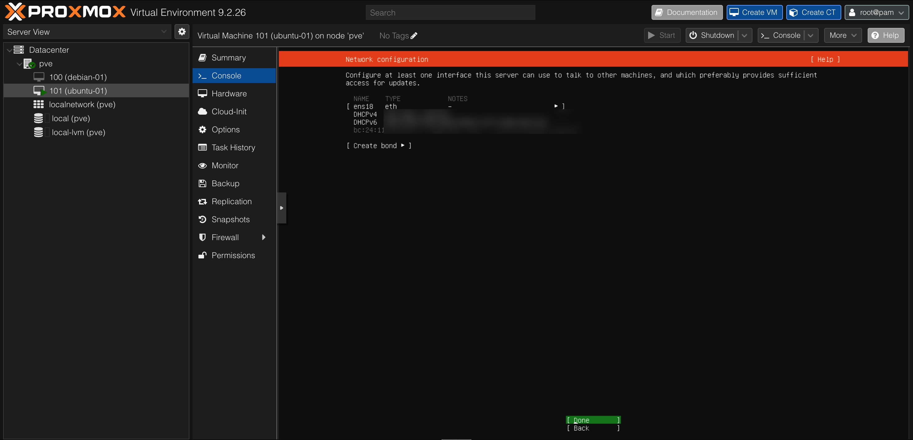
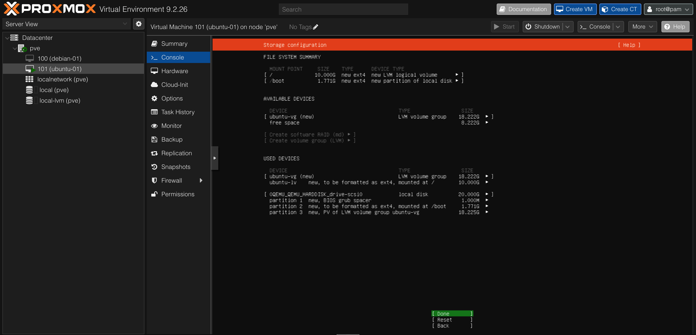
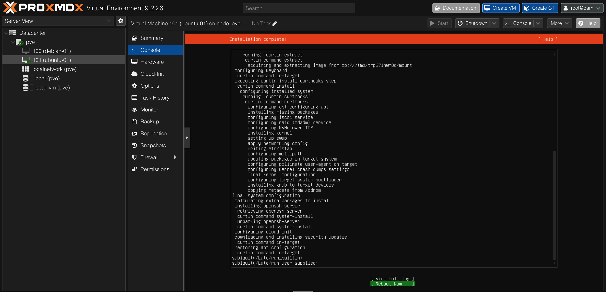
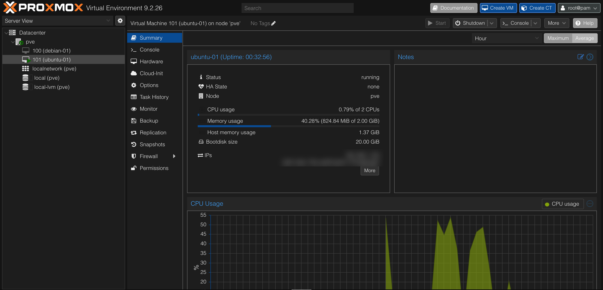
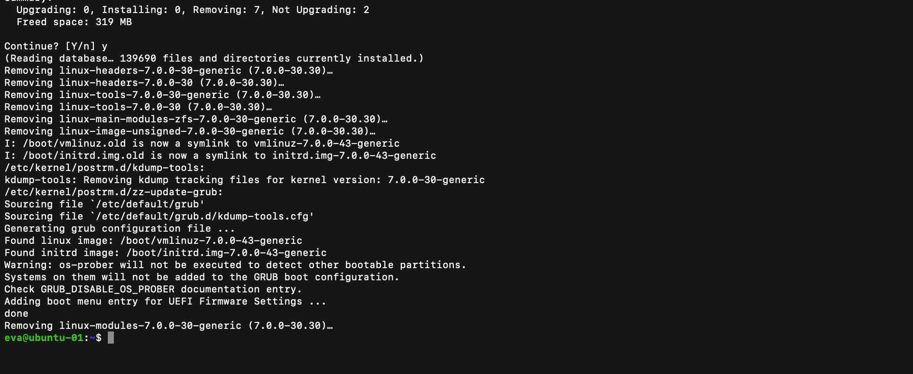
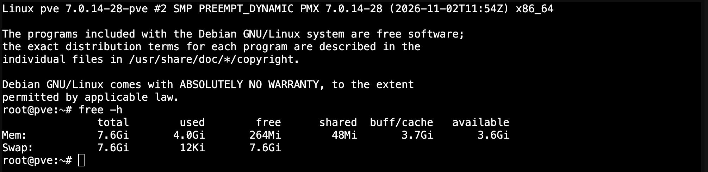
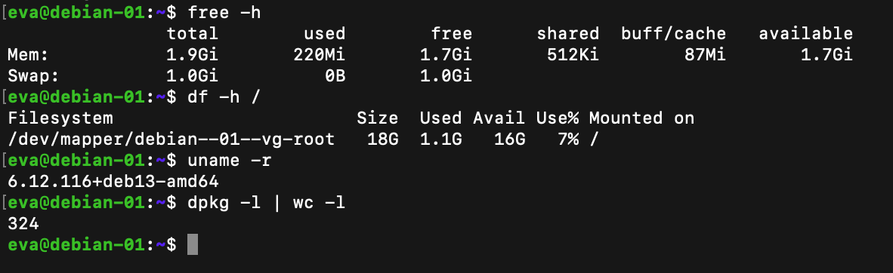
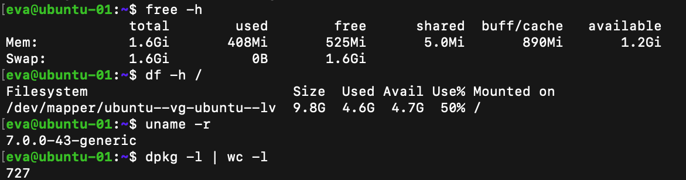

# 05 — Second Linux VM: Ubuntu Server (and how it differs from Debian)

> 🚧 **In progress.** This README is written step by step during the project, mistakes included.

## Objective
Install **Ubuntu Server 26.04.1 LTS** as a second VM next to `debian-01`, then **compare the two distributions**: installer, defaults, resource usage and philosophy. The goal isn't just "I installed Ubuntu", but understanding why a company would choose one or the other.

## Concept: same family, different choices
Ubuntu is built **on top of Debian**: Canonical takes Debian, adds its own choices and tooling, and ships a release every 6 months, with an LTS every 2 years. Same family (`apt`, `systemd`, same filesystem layout), but different defaults.

| | Debian 13 | Ubuntu Server 26.04 LTS |
|---|---|---|
| Made by | Volunteer community | A company (Canonical) |
| Philosophy | Stable, minimal, "you decide" | Up to date, "batteries included" |
| Installer | Classic text installer (d-i) | **Subiquity**, a newer, guided installer |
| Root account | Optional (I disabled it) | Always disabled, sudo user by default |
| Extras | Almost none | Snaps, cloud-init, Ubuntu Pro… |
| Where you meet it | Many servers and appliances (**Proxmox itself runs on Debian**) | The most common Linux in the public cloud (AWS / Azure / GCP images) |

Why both matter for my goal: Debian is under my hypervisor; Ubuntu is what I'll meet in the cloud (Phase 4).

## Prediction before starting
> The Ubuntu Server ISO is **2.7 GB**, the Debian netinst was **756 MB**. Why ~4× bigger?

**My guess:** the two installs work differently. Ubuntu's is more of a "live" system, and they don't use the network the same way (the Debian install felt longer because it kept downloading).

**The real reason:** that was the right intuition.

| | Debian **netinst** (756 MB) | Ubuntu **live-server** (2.7 GB) |
|---|---|---|
| What's on the ISO | A small installer + just enough to start | A **complete, ready-made Ubuntu system** that boots ("live") and runs the installer from inside it |
| Where the packages come from | **Downloaded from the internet during the install** ("net" install) | Already on the ISO: the installer **copies the pre-built system** onto the disk |
| Without internet | Very limited install | Works offline, updates fetched afterwards |
| Trade-off | Small download, longer install, always up to date | Big download, faster and more predictable install |

So the size difference isn't about Ubuntu being "heavier" once installed. It's about **where the work happens**: before (Ubuntu ships everything in the ISO) or during the install (Debian fetches it). My Debian install took longer partly because of that, and partly because of my GNOME mistake (1,379 packages downloaded through the Wi-Fi extender).

## Steps

### 1. Download the ISO directly on Proxmox (with checksum)
This time the ISO goes straight from Ubuntu's servers to the Proxmox host (**local → ISO Images → Download from URL**), instead of Mac → upload. The 2.7 GB never pass through my laptop.

| Field | Value | Why |
|---|---|---|
| URL | `https://releases.ubuntu.com/26.04.1/ubuntu-26.04.1-live-server-amd64.iso` | Official source, HTTPS |
| Query URL | file name + **2.73 GiB**, MIME `application/x-iso9660-image` | Proxmox checks the link works and that it's really a disc image |
| Hash algorithm | **SHA-256** | |
| Checksum | the 64-hex hash from the official `SHA256SUMS`, line `ubuntu-26.04.1-live-server-amd64.iso` | Proxmox refuses to keep the file if the hash doesn't match |
| Verify certificates | ✅ | Makes sure I'm really talking to `releases.ubuntu.com` |


**Result:** task **OK** (13:22:23 → 13:26:52, ~4.5 min). The ISO is now in the library next to Debian's (2.73 GiB vs 756 MiB). Download speed was steady around **11 MB/s ≈ 90 Mbit/s**, much lower than the 440–560 Mbit/s Wi-Fi speed test at the desk: the Wi-Fi extender relays everything over the same radio (roughly halving throughput), and the remote mirror's speed matters too.


The release folder also contains `SHA256SUMS.gpg`: a **signature** of the hash list, proving it comes from Canonical (same idea as Debian's `.sign`).

### 2. Create VM 101 `ubuntu-01` (same specs as `debian-01`)
Same hardware as the Debian VM, so the comparison is fair: 2 vCPU, 2 GiB RAM, 20 GiB disk (Discard + SSD emulation + IO thread), VirtIO NIC on `vmbr0`, Qemu Agent on.



### 3. Install with Subiquity
First visible differences from Debian's installer: an orange header, **[ Done ] / [ Back ]** buttons on every screen, and no 30-second boot-menu trap (GRUB starts the live system by itself).

- **Keyboard:** the default was English (UK). Changed to **French / French** (PC variant, because the Proxmox console sends PC key positions).
- **Network:** Subiquity **shows the network result directly** (Debian's installer didn't): `ens18` got a DHCPv4 lease in `192.168.1.X/24`, a public DHCPv6 address, and a MAC starting `BC:24:11` (Proxmox prefix, "Red Hat, Inc. / Virtio network device"). Second confirmation that VMs get their own lease **behind the Wi-Fi extender**.



- **Mirror:** the log starts with `file:/cdrom resolute Release`. The installer uses **the ISO itself as a package source** and only fetches update indexes from `archive.ubuntu.com` (274 kB). That's the live-server vs netinst difference, visible in the log.
- **Storage:** guided, entire disk + LVM, no encryption. The summary shows a classic Ubuntu surprise:

| | Debian `debian-01` | Ubuntu `ubuntu-01` |
|---|---|---|
| Volume group name | `debian-01-vg` (from the hostname) | `ubuntu-vg` (fixed name) |
| `/boot` | ~1 GB partition | 1.77 GB partition |
| Root `/` | **19.3 GB**: the whole VG | **10 GB** only, **8.2 GB left free** in the VG |
| Swap | `swap_1` logical volume | No swap volume (Ubuntu uses a **swap file** instead) |

Ubuntu deliberately leaves part of the volume group unallocated, so the admin can later decide which volume grows. That's the LVM flexibility discussed in project 04. I kept the default and will extend `/` myself after the install (`lvextend`), as a real admin task.



- **Profile:** name `ubuntu-01`, user `eva`, with a **different password from `debian-01`** (no reuse: if one machine is compromised, the password can't be replayed on the other, which is lateral movement).
- **Ubuntu Pro:** skipped (free for personal use on 5 machines, but ties the VM to an online account; can be enabled later with `sudo pro attach`). Debian has no commercial layer like this.
- **SSH:** `[X] Install OpenSSH server` ticked with **Space** (unticked by default). Password authentication allowed for now, until SSH keys in project 10.
- **Featured snaps:** none selected. Only install what the server needs.
- **Install log:** `acquiring and extracting image from cp:///tmp/.../mount` confirms the installer **copies a pre-built system image** instead of installing package by package; `setting up swap` creates a swap **file**; `downloading and installing security updates` patches the system before first boot.



### 4. First boot
- At *"Please remove the installation medium"*: pressed Enter, then ejected the ISO afterwards (**Hardware → CD/DVD → Do not use any media**, applied live). No boot problem this time: a new VM's boot order is already **disk first**.
- At first boot, **cloud-init** generates the SSH host keys (RSA, ECDSA, ED25519) and prints their fingerprints on the console, the reference to compare against at the first SSH connection.
- The login banner (MOTD) already shows a lot: `/` used at **50.6 % of 9.75 GB** (confirms the small root volume), **45 updates** available, an Ubuntu Pro/ESM reminder, the IPv4/IPv6 addresses, and times in **UTC**: the installer never asked for a timezone, unlike Debian's.

### 5. Post-install fixes over SSH (live, no reboot)
SSH from the Mac; the host-key fingerprint matched the ED25519 one printed by cloud-init on the console.

```bash
sudo hostnamectl set-hostname ubuntu-01      # fix the AZERTY typo
sudo apt install qemu-guest-agent            # Ubuntu Server doesn't install it (Debian did)
sudo systemctl start qemu-guest-agent
systemctl status qemu-guest-agent            # active (running)
```

- **Guest Agent:** Proxmox showed *"Guest Agent not running"* even though `agent: 1` was set. That option only creates the **channel on the host side**; a program must answer **inside** the guest. Debian's installer added it automatically, Ubuntu's didn't. After the install, the unit shows as `static`: it isn't "enabled", it's started automatically when the virtio channel appears, so it survives reboots.
- **`sudo-rs`:** the prompt is `[sudo: authenticate] Password:` instead of Debian's `[sudo] password for eva:`. Ubuntu now ships **sudo rewritten in Rust** (memory-safe), removing a whole class of memory-corruption bugs from a security-critical binary.
- **`hostnamectl`** also reveals the emulated hardware: `Hardware Model: Standard PC (i440FX + PIIX, 1996)`, the classic chipset Proxmox emulates by default for compatibility, and `Virtualization: kvm`.

Then I fixed `/etc/hosts` and the timezone, **building the commands myself** from `--help` (read the left column = what to type; CAPITALS = values to replace):

```bash
cat /etc/hosts                                   # before
sudo sed -i 's/ubuntu-06/ubuntu-01/' /etc/hosts  # no output = success
cat /etc/hosts                                   # after: 127.0.1.1 ubuntu-01
timedatectl                                      # before: Etc/UTC
sudo timedatectl set-timezone Europe/Paris       # "europe/paris" would fail: Linux is case-sensitive
timedatectl                                      # after: Local time 14:30 CET, Universal time unchanged
```

Only the **display** changed: `Universal time` and the NTP-synchronised clock stayed the same. After reconnecting, the prompt shows `eva@ubuntu-01`.

Result: Proxmox now reads the VM's IPs through the agent. VM cost on the host: **1.37 GiB** for 824 MiB used inside the guest.



### 6. Updates
```bash
sudo apt update && sudo apt full-upgrade   # 48 packages upgraded
sudo apt autoremove                        # 7 old kernel 7.0.0-30 packages removed, 319 MB freed
```
Same `apt` commands as Debian (the shared family), but Ubuntu adds its own behaviour on top:
- **Phased updates:** `Not upgrading yet due to phasing` means Canonical rolls some updates out to a percentage of machines first, to catch bugs before everyone gets them.
- **needrestart:** after upgrading, Ubuntu **automatically restarted** the services using updated libraries (`ssh`, `cron`, `qemu-guest-agent`…) and listed sessions still running old binaries.
- **unattended-upgrades** is present and enabled: Ubuntu installs **security updates automatically** by default. Debian doesn't. On a server that's a trade-off between being patched quickly and controlling exactly when things change.
- `autoremove` removed the ISO's original kernel (`-30`) because `-43` is now installed; `/boot/vmlinuz.old` now points to `-43`.
- The `File descriptor 3 … leaked on vgs invocation` lines are a harmless warning from GRUB's disk probe talking to LVM.




## Comparison: Debian vs Ubuntu side by side

### Resource cost on the host (both VMs running)

| | `debian-01` | `ubuntu-01` |
|---|---|---|
| Uptime at measurement | 54 s (just booted) | 55 min (after installs + 48 upgrades) |
| RAM used **inside** the guest | 164 MiB | 1.09 GiB |
| RAM taken **on the host** | 302 MiB | **1.91 GiB** |

Host `free -h` with both running: **used 4.0 GiB / 7.6 GiB, available 3.6 GiB**, swap 12 KiB (negligible), KSM 0 B.
My prediction was ~3.2 GiB (1.6 for Proxmox + 0.8 per VM, from project 04). Reality was **4.0 GiB**.

**What I learned:** a VM's host memory isn't fixed. It grows with what the guest has **touched**: Ubuntu filled its RAM with page cache while downloading and installing updates, and that memory stays allocated to the VM. Since ballooning has min = max, Proxmox never takes it back. So a fair comparison needs both VMs in the **same state** (same uptime, same workload). The real planning rule: **budget each VM at its full RAM size**, which is what the roadmap assumes.



### Inside each VM (same hardware: 2 vCPU, 2 GiB, 20 GiB)

```bash
free -h            # RAM
df -h /            # root filesystem
uname -r           # kernel
dpkg -l | wc -l    # installed packages (the pipe | sends the list into a line counter)
```

| Measure | Debian 13 `debian-01` | Ubuntu 26.04.1 `ubuntu-01` | Why |
|---|---|---|---|
| RAM **visible** to the OS | 1.9 GiB | **1.6 GiB** | Ubuntu enables **kdump** (crash dumps): the kernel reserves ~300 MB at boot (`crashkernel`) to capture a crash. That RAM is invisible to the OS |
| Swap | 1.0 GiB **partition** (`swap_1` LV) | 1.6 GiB **file** (`/swap.img`) | Ubuntu prefers a swap file, which is easier to resize |
| Root `/` size | 18 GB (whole VG) | **9.8 GB** (8 GB left free in the VG) | Ubuntu's guided LVM keeps space in reserve |
| Root `/` used | **1.1 GB (7 %)** | **4.6 GB (50 %)** | Ubuntu ships much more by default (snapd, cloud-init, kdump, multipath, iscsi…) |
| Installed packages | **~319** | **~722** | Minimal vs "batteries included" (`dpkg -l` includes ~5 header lines) |
| Kernel | **6.12** (`6.12.116+deb13`) | **7.0** (`7.0.0-43-generic`) | Debian favours proven versions, Ubuntu newer ones |
| Device-mapper name | `debian--01--vg-root` | `ubuntu--vg-ubuntu--lv` | The `-` in names is doubled in `/dev/mapper` to escape it |




## Problems & fixes
| Problem | Cause | Fix / lesson |
|---|---|---|
| The ISO also started downloading **on my Mac** | I clicked the ISO link on the Ubuntu page | Cancelled it. Proxmox downloads its own copy; only the hash needs to be copied from the site |
| Typed `SHA256SUMS` in the Checksum field | Confused the **name** of the hash list with the **hash** itself | Opened `SHA256SUMS` and copied the 64-character hex string. Caught before downloading 2.7 GB for nothing |
| Wizard showed Qemu Agent ❌, disk **32 GiB**, Discard ❌, SSD ❌, **1 core** | I assumed the wizard **remembered my Debian settings**. It doesn't: every new VM starts from Proxmox defaults | Went back through each tab and fixed 5 values before Finish. Lesson: manual setup drifts. That's why admins use **templates** and **automation** (Terraform, Phase 4) |
| Typed `europe/paris` | Linux paths and names are **case-sensitive** (zones are files under `/usr/share/zoneinfo/Europe/Paris`) | `Europe/Paris` |
| Hostname came out as **`ubuntu-06`** instead of `ubuntu-01` | AZERTY again: on a **PC** AZERTY layout, digits need Shift, and the `6` key types `-`, so one key press landed on the wrong character in the console | Fixed after install over SSH (`hostnamectl`), from the Mac keyboard. Unlike Debian, the VG name doesn't depend on the hostname (`ubuntu-vg`), so the fix is easy |
| Two `live-server` lines in `SHA256SUMS` | The folder holds **26.04** (April) and **26.04.1** (August) | Took the `26.04.1` line, matching the file I'm downloading, and copied it from the official page myself, never from a third party |
