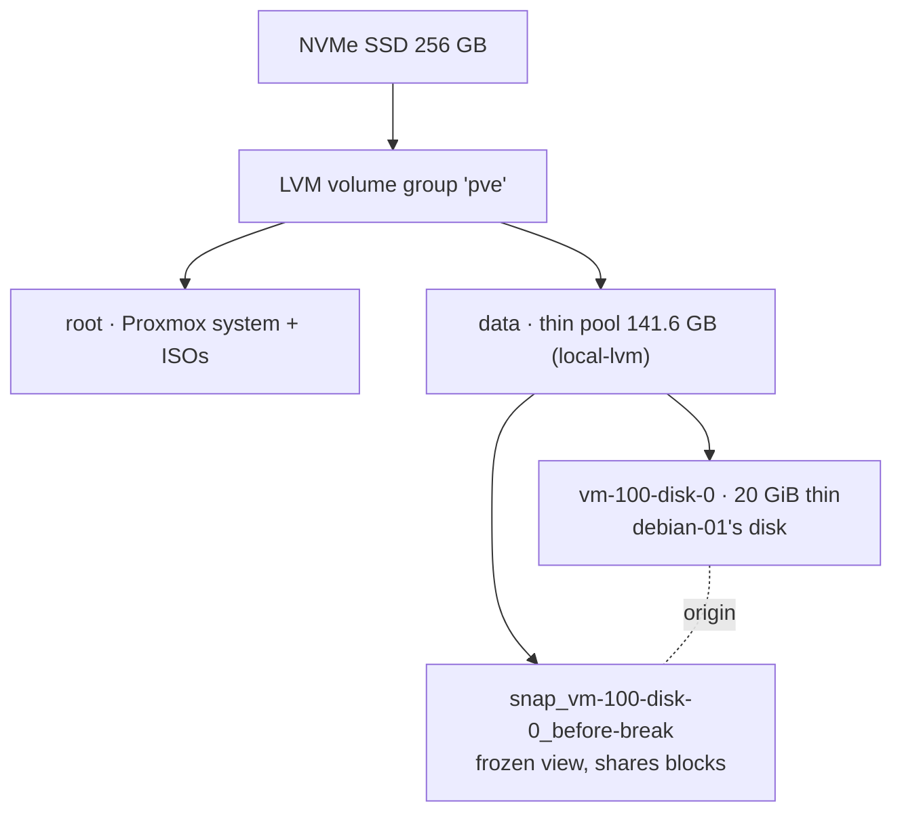
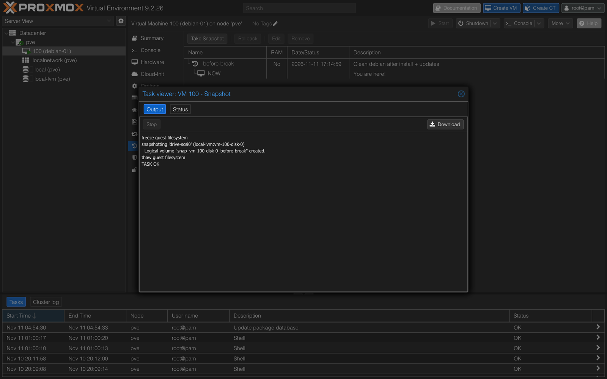
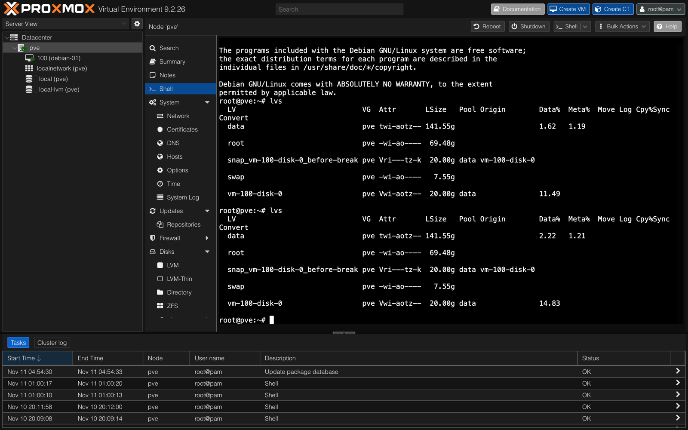
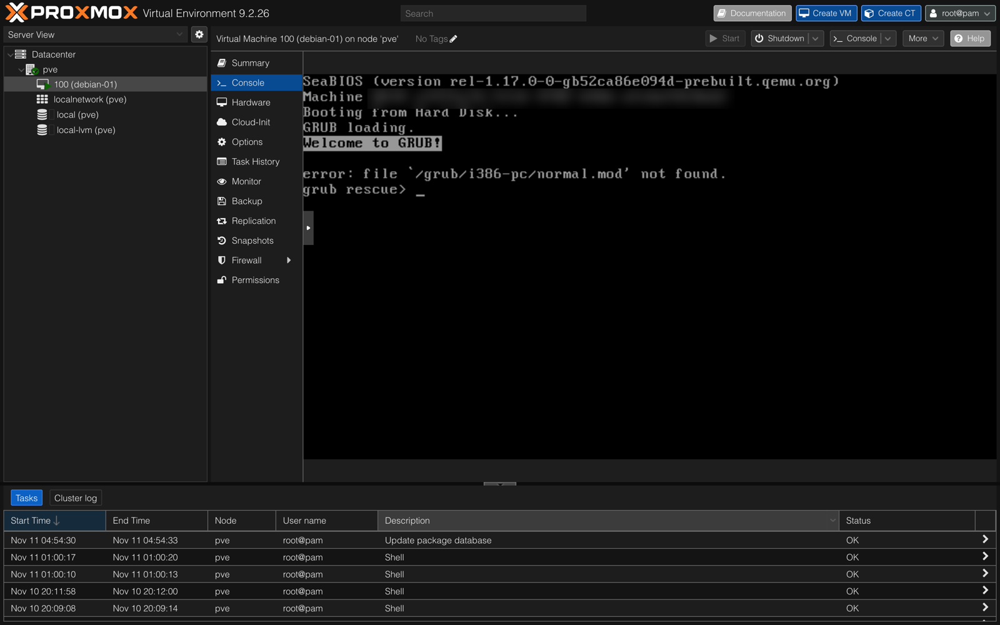
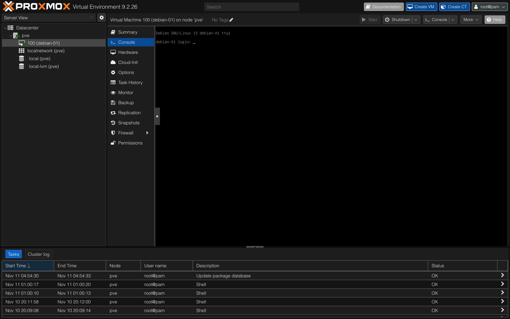
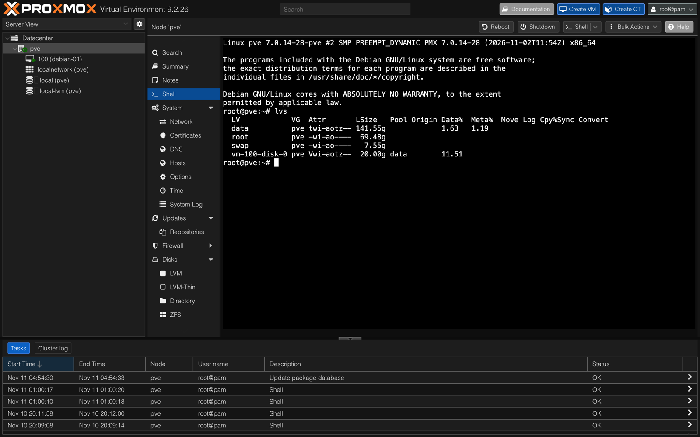

# 06 — Snapshots: break it, roll it back

## Objective
Understand what a VM snapshot really is: what it saves, where it lives, what it costs and when to use it. Then prove it by deliberately making `debian-01` unbootable and restoring it in one click.

## Concept first
A snapshot is a **save point of the whole VM**. It freezes the disk, and optionally the RAM, so everything that happens afterwards can be undone.

| Question | Answer |
|---|---|
| What is saved? | The VM's disk at that moment (RAM optional, not used here) |
| Where does it live? | **On the same SSD** as the VM, as an LVM-thin volume in the `data` pool (`local-lvm`) |
| How does it work? | **Copy-on-write**: nothing is copied at creation, and only changes after the snapshot use new blocks |
| What does rollback do? | Returns the VM to that exact moment. Everything after it is lost (all or nothing, no merge) |
| How long to keep it? | Minutes to days: take → change → test → **delete** (OK) or **rollback** (broken) |
| Is it a backup? | **No.** It lives on the same SSD, so if the SSD dies, the VM and its snapshots die together |

Protection layers (the **3-2-1 rule**: 3 copies, 2 media, 1 off-site):

| Layer | Protects against | Where |
|---|---|---|
| Snapshot | My own mistakes, a bad update | Same SSD, temporary |
| Backup | Dead SSD, deleted VM | Another disk (project 19) |
| Off-site copy | Fire, theft, everything at home lost | Outside home / cloud |

Rule of thumb: **"If this goes wrong, can I easily fix it? If not, snapshot first."**

## Architecture



## Steps

### 1. Witness file (inside the VM, over SSH)
```bash
echo "before the snapshot - $(date)" > ~/witness.txt
```

### 2. Take the snapshot (Proxmox: VM → Snapshots → Take Snapshot)
- Name `before-break`, **Include RAM: no**.
- Took ~2 seconds. The log shows the Guest Agent freezing the filesystem for a clean, consistent snapshot:
```
freeze guest filesystem
snapshotting 'drive-scsi0' (local-lvm:vm-100-disk-0)
  Logical volume "snap_vm-100-disk-0_before-break" created.
thaw guest filesystem
TASK OK
```

### 3. Change things after the snapshot
```bash
echo "after the snapshot - $(date)" >> ~/witness.txt
dd if=/dev/urandom of=~/bigfile bs=1M count=1024 status=progress   # 1 GiB of new data
```
Then on the host:
```bash
lvs
```

### 4. Break the VM
```bash
sudo rm -rf /boot/*     # deletes the kernel and GRUB files
sudo reboot
```
Result: `error: file '/grub/i386-pc/normal.mod' not found` → `grub rescue>`. The VM is unbootable.

### 5. Roll back (Proxmox: Snapshots → `before-break` → Rollback)
The VM is stopped, its disk is reverted, then started again → `debian-01 login:`.

### 6. Verify, then delete the snapshot
```bash
cat ~/witness.txt    # only the "before" line
ls -lh ~/bigfile     # No such file or directory
ls /boot             # grub, kernels and initrd all back
```
Snapshot removed in Proxmox (Snapshots → Remove), then `lvs` on the host again.

## Tests and measurements (`lvs` on the host)

| | Before snapshot | After writing 1 GiB | After rollback + snapshot deleted |
|---|---|---|---|
| Snapshot volume | (none) | present, shares blocks with the disk | **gone** |
| `vm-100-disk-0` Data% (of 20 GiB) | 11.49 % | 14.83 % | **11.51 %** |
| `data` pool Data% (of 141.55 GiB) | 1.62 % | 2.22 % (≈ +0.85 GiB) | **1.63 %** |

| Test | Result |
|---|---|
| Snapshot creation copies nothing (instant, pool unchanged) | ✅ 2 s, pool still 1.62 % |
| Data written after the snapshot is lost on rollback | ✅ `bigfile` and the "after" line are gone |
| Data present at snapshot time is restored | ✅ `/boot` fully back, VM boots |
| Deleting the snapshot keeps the VM intact | ✅ VM running, only the save point removed |

## Screenshots
| Step | Screenshot |
|---|---|
| Snapshot taken: freeze → LV created → thaw |  |
| `lvs` before and after writing 1 GiB |  |
| Broken VM: `grub rescue>` |  |
| After rollback: boots to login |  |
| `lvs` after deleting the snapshot |  |

## Problems & fixes
| Problem | Cause | Fix / lesson |
|---|---|---|
| `ssh: connect to host … port 22: Operation timed out` | The VM got a **new DHCP address** after being shut down | Read the current IP in Proxmox Summary → IPs (Guest Agent). DHCP reservation planned in project 13 |
| SSH asked to trust the host again | New IP, same key: SSH said *"this host key is known by other addresses"* | Confirmed the same fingerprint, so it's the same VM |
| `dd: failed to open 'dev/urandom'` | **Relative path** (no leading `/`), looked inside `/home/eva` | Use the absolute path `/dev/urandom` |
| Ran the checks on the Mac instead of the VM | The rollback rebooted the VM and closed SSH; the prompt was back to `ATOM@evas-laptop` | **Always read the prompt** before typing, especially before destructive commands |

## What I learned
- Booting is a relay: BIOS → GRUB stage 1 (start of the disk) → GRUB modules in `/boot/grub` → kernel in `/boot`. That's why "Welcome to GRUB!" still appeared before the failure.
- Thin provisioning: a 20 GiB disk only uses what's written. Watch the **`data` pool** %, not just the VM disk %, to know if the SSD is filling up.
- The real cost of a long-lived snapshot comes from **changing or deleting data that existed before it**: the old version must be kept, so the space can't be freed.
- Debian keeps the previous kernel in `/boot` as a fallback, another built-in "way back".
- 🔐 Glance at `Last login: … from …` at each login: an unknown time or address means someone else got in.
- 🔐 `rm -rf` as root only ever runs right after a fresh snapshot, and only after checking the prompt.

## Result
✅ Full snapshot lifecycle done: take → change → break → rollback → verify → delete. Measured with `lvs`, so I can explain what happens on disk at each step.
