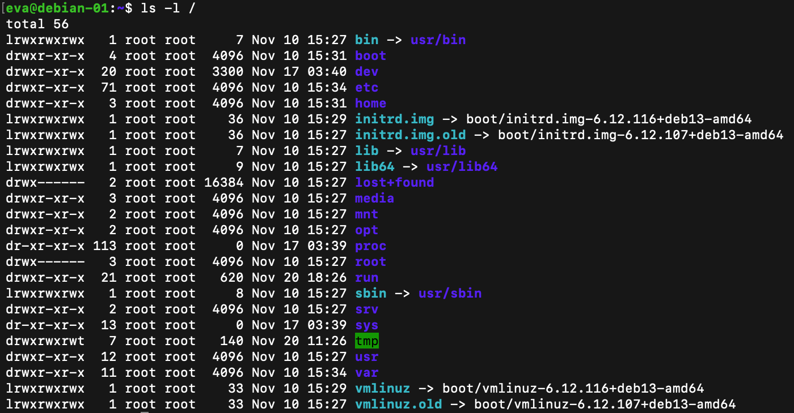

# 07 — Linux file structure

## Objective
Understand **where things live** on a Linux server (the FHS, Filesystem Hierarchy Standard), then:
1. explore the real tree on `debian-01`,
2. create a clean directory layout for several services, placed where the standard expects them,
3. write my own **command guide** ([`cheatsheet.md`](../../cheatsheet.md)), explained in my own words.

## Concept: one single tree
Linux has **one tree** starting at `/`. There are no drive letters: a disk or partition is **mounted** onto a folder (like `ubuntu-lv` mounted on `/` in project 05). The layout follows the **FHS**, so every Linux server is organised the same way and an admin knows where to look on any machine.

| Directory | What lives there | Already met in this lab |
|---|---|---|
| `/etc` | Configuration files (text) | `/etc/hosts`, `/etc/ssh/` |
| `/var` | Variable data: logs (`/var/log`), caches, databases, web content | — |
| `/srv` | Data a server **serves** (website, files) | — |
| `/opt` | Add-on software installed outside the package manager | — |
| `/usr` | Installed programs and libraries (`/usr/bin`, `/usr/lib`) | `/usr/share/zoneinfo/Europe/Paris` |
| `/home`, `/root` | Users' personal files / the root user's home | `~` = `/home/eva` |
| `/boot` | Kernel + bootloader | deleted on purpose in project 06 → `grub rescue>` |
| `/dev`, `/proc`, `/tmp` | Devices as files, live kernel/process info, temporary files | `/dev/urandom`, `/dev/mapper/…` |

**Key idea:** a service is **split by type of file**, not kept in one folder: program in `/usr/bin`, config in `/etc/<service>`, logs in `/var/log/<service>`, data in `/var/lib/<service>` or `/srv`.

## Prediction before starting
_(to fill in)_

## Steps

### 1. Explore the real tree on `debian-01`
```bash
ls /                 # names only
ls -l /etc | less    # details, one page at a time (q = quit, /word = search)
ls -l /              # details of the top of the tree
```

**How to read one `ls -l` line:**
```
-rw-r--r-- 1 root root 211 Nov 10 15:27 hosts
│└──┬────┘   └──┬───┘  │   └────┬─────┘ └ name
│   │           │      │        └ last modified (= the day I installed debian-01)
│   │           │      └ size in bytes
│   │           └ owner and group
│   └ permissions (project 08)
└ type: - file · d directory · l link (shortcut)
```

**What `ls -l /` revealed:**

| Entry | What I saw | What it means |
|---|---|---|
| `bin`, `sbin`, `lib`, `lib64` | `l` + `-> usr/bin`, `-> usr/sbin`… | Not real folders: **symbolic links** kept for old scripts. The real programs live in `/usr` (Debian's "merged /usr") |
| link sizes 7, 8, 9 | `bin -> usr/bin` = **7** | A symlink is a tiny file holding an **address**; its size is the length of that text (`usr/bin` = 7 characters) |
| `vmlinuz` / `vmlinuz.old` | `-> boot/vmlinuz-6.12.116…` / `-> …6.12.107…` | The **current kernel** and the **previous one**, kept as a fallback if a new kernel fails to boot. Same for `initrd.img` |
| `proc`, `sys` | size **0**, dated at the last boot | **Virtual** folders created in memory by the kernel: nothing on disk |
| `root`, `lost+found` | `drwx------` | Only root can enter |
| `tmp` | `drwxrwxrwt` | Everyone can write, but the final **`t`** (sticky bit) means you can only delete **your own** files (project 08) |
| `/etc/gshadow`, `/etc/credstore` | `-rw-r-----` / `drwx------` | Unlike most of `/etc` (readable by all), files holding **secrets** are locked down by permissions |



🕵️ **Side finding:** `proc`, `sys` and `dev` were dated **Tue 03:39** while I logged in on **Friday**. That's the VM's boot time, so `debian-01` had been running for **3 days** after I forgot to shut it down, holding 2 GiB of the host's 8 GB. The filesystem itself told me. Lesson: always `exit` + **Shutdown** at the end of a session.

## Steps

### 1. Explore the real tree on `debian-01`
```bash
ls /                 # names only
ls -l /etc | less    # long format, page by page (q = quit, /word = search)
ls -l /              # long format of the root: reveals types and shortcuts
```
Pattern of almost every command: **`command -options target`** (`ls` = list, `-l` = long format, `/` = which folder).


How to read the first letter and the arrows:
| Seen | Meaning |
|---|---|
| `d` | directory |
| `l` + `->` | **symbolic link** (shortcut) to another path |
| `bin -> usr/bin`, `sbin`, `lib`, `lib64` | Old top-level folders are now shortcuts into `/usr` ("merged /usr"). Old scripts calling `/bin/bash` still work |
| `vmlinuz -> boot/vmlinuz-6.12.116…` / `vmlinuz.old -> …6.12.107…` | Current kernel and the **previous one kept as a fallback** if an update breaks booting |
| `proc`, `sys`: size **0**, date = last boot | Not on disk: the kernel builds them **in memory** at every boot |
| `run`: date = now | Live runtime data (PIDs, sockets), wiped at boot |
| Most folders dated **Nov 10 15:27** | The minute `debian-01` was installed (project 04) |

Permission oddities spotted (→ project 08):
- `/root` and `/lost+found` → `drwx------`: only root can enter.
- `/tmp` → `drwxrwxrwt`: **everyone** can write, but the **sticky bit** `t` means you can only delete **your own** files.
- In `/etc`, `gshadow` (`-rw-r-----`, group `shadow`) and `credstore` (`drwx------`) are **not** world-readable: they hold password and credential data.
